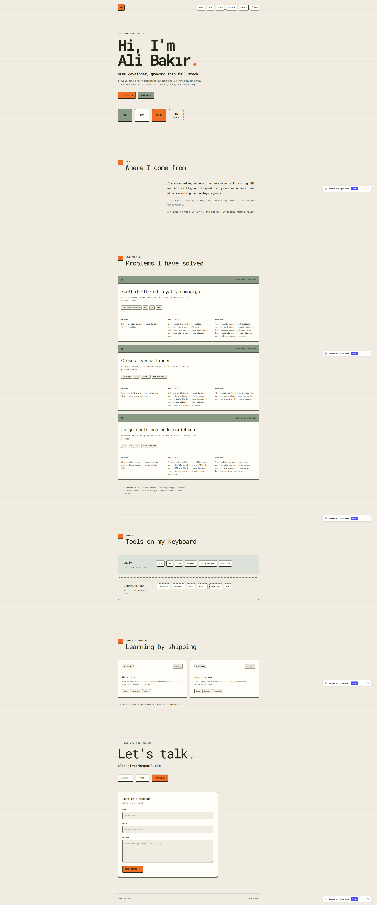

# Ali Bakır — Portfolio

Personal portfolio of **Ali Bakır**, an SFMC Developer growing into Full Stack Web Development. Built from scratch with zero frameworks or build steps, focusing on semantic HTML, layered CSS architecture, keyboard accessibility, and performance.

🔗 **Live Site:** [https://alibakir-dev.github.io/portfolio/](https://alibakir-dev.github.io/portfolio/)



## Tech Stack

- **HTML5:** Semantic landmarks (`header`, `nav`, `main`, `section`, `article`, `footer`), skip-link navigation, Open Graph meta tags.
- **CSS3:** Primitive & semantic design tokens (`tokens.css`), mobile-first responsive grids, fluid typography (`clamp()`), light/dark themes, and `prefers-reduced-motion` support.
- **Vanilla JavaScript:** Flash-free theme initialization (`localStorage` + `prefers-color-scheme`) and accessible mobile navigation (`aria-expanded`, `Escape` key handling, focus management).

## Lighthouse Scores (Mobile)

- **Performance:** 99
- **Accessibility:** 100
- **Best Practices:** 100
- **SEO:** 100

## Run Locally

1. Clone the repository:
   ```bash
   git clone https://github.com/alibakir-dev/portfolio.git